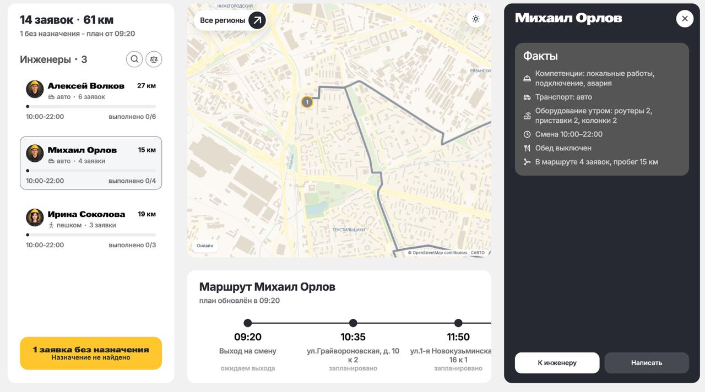

# Navix

Веб-сервис интеллектуального планирования и живого перепланирования маршрутов
выездных инженеров. Кейс «Билайн Бизнес» (номинация «Логистика»), ЛЦТ 2026.

Navix собирает день в один инструмент, которому диспетчер может доверять: план
за секунды, карта с дорожной геометрией, короткое объяснение каждого назначения,
измеренная надёжность и перепланирование, которое видно до того, как его приняли.
Маршруты считает детерминированное ядро. Языковая модель объясняет уже
посчитанные факты и не меняет план сама.



## Публичный стенд

| Контур | Адрес |
| --- | --- |
| Диспетчер | <https://navix.droidje.com/> |
| Инженер | <https://navix.droidje.com/engineer/> |
| Клиент | <https://navix.droidje.com/client/> |

День на публичном стенде идёт значительно быстрее обычного рабочего дня: так
удобнее пройти смену, алерты и перепланирование за несколько минут.

## Материалы

| | |
| --- | --- |
| Схемы проекта | [FigJam](https://www.figma.com/board/2pI0eteaxOHNzDwEVKYPox/%D0%9B%D0%A6%D0%A2-core-%7C-%D0%9C%D0%98%D0%A1%D0%98%D0%A1---%D1%81%D1%85%D0%B5%D0%BC%D1%8B?node-id=0-1&t=2pLV01VjYlJC6SI1-1) |
| Дизайн-макет | [Figma](https://www.figma.com/design/logt6LVbV7OvvAM75EL4mb/LCT-core-%7C-%D0%9C%D0%98%D0%A1%D0%98%D0%A1?node-id=0-1&t=amW0luk6Y9G0fz9S-1) |
| Презентация | [Google Slides](https://docs.google.com/presentation/d/1rwDCUcFaaPNe_iqUketsOQh8tHM6jfSe1wQAN0qbAO4/edit?usp=sharing) |
| Промо-ролик | [YouTube](https://youtu.be/-cI_pmy76bY) |
| Описание проекта | Ссылка приложена при сдаче решения на платформе ЛЦТ. В описании есть секреты, поэтому в репозиторий оно не входит. |

Почта и пароль диспетчера, PIN для получения окружения в лаунчере и классический
файл окружения лежат по той же ссылке на Google Drive, которая приложена к сдаче.

Для оценки по кейсу: [ядро ТЗ и дополнительные функции](docs/core-and-extensions.md),
[сценарий проверки](docs/tz-acceptance.md).

## Как запустить

Основной способ — окно лаунчера. Оно проверяет Python, Docker и целостность
пакета, забирает секреты и поднимает весь контур.

| Система | Из корня репозитория |
| --- | --- |
| Windows | `windows-gui.cmd` |
| macOS / Linux | `sh unix-gui.sh` |

Те же сценарии лежат в `launch/windows-gui.cmd` и `launch/unix-gui.sh`.
Нужны Python 3.10+ с Tkinter и Docker с Compose. Лаунчер не ставит их сам.

В мастере выберите полный запуск (интерфейс, API, база и планировщик). Почту и
пароль диспетчера мастер спрашивает отдельно. После старта дашборд открывается
на локальном адресе, который покажет лаунчер.

Рекомендуем онлайн-запуск. Секреты лаунчер получает с платформы дистрибуции
<https://distribute.droidje.com> по PIN. PIN, учётные данные диспетчера и файл
окружения для офлайн-запуска — на Google Drive из сдачи на платформе ЛЦТ.

### Локальная проверка

Лаунчер поднимает всё необходимое: базу, ядро, API и интерфейс. Для жюри и
обычной проверки достаточно онлайн-запуска с PIN. Офлайн-режим берёт тот же
файл окружения с Google Drive и не ходит за секретами на платформу дистрибуции.

`pnpm smoke` — сквозная проверка с нуля. Она сбрасывает данные и предназначена
только для своей машины, не для базы стенда.

Подробности лаунчера — [docs/launcher.md](docs/launcher.md). Диагностика —
[docs/runbook.md](docs/runbook.md).

### Традиционный запуск

Запасной путь, если окно лаунчера не нужно. Нужен Docker Compose. Для команд
через pnpm — Node.js ≥ 24.13.0 и pnpm 10.28.2.

```bash
git clone https://git.sourcecraft.dev/lct-hackaton-2026/case-13-field-engineer-routing-team-22 LCT_smart_router
cd LCT_smart_router
cp .env.example .env
docker compose -f infra/docker-compose.yml up -d --build
```

Файл окружения для этого пути — тот же, что на Google Drive из сдачи. В
`.env.example` секретов нет: почту и пароль диспетчера нужно задать самим или
подставить полученный файл.

| Сервис | Адрес |
| --- | --- |
| Дашборд | <http://127.0.0.1:5173> |
| API | <http://127.0.0.1:8000/docs> |
| Router Core | <http://127.0.0.1:8100> |
| PostgreSQL | `127.0.0.1:5432` |

При `DEMO_STAND=true` (значение по умолчанию) контур сам поднимает день из
14 заявок и 3 инженеров.

## Как смотреть публичный стенд

1. Откройте [дашборд диспетчера](https://navix.droidje.com/). Вход — почта и
   пароль. Оба значения обязательны; они лежат на Google Drive из сдачи.
2. На экране приветствия нажмите «Начать рабочий день». Если день уже открыт и
   его нужно вернуть к началу — меню у аватара справа, пункт «День заново».
3. Кроме уже загруженного дня данные можно добавить кнопкой «Загрузить данные»
   или через «+»: сет из ТЗ, свой файл, заявка, инженер.
4. Снять инженера со смены: вкладка «Инженеры», карточка, «Снять со смены».
   План пересобирается, панель дельты показывает, что изменилось.
5. Авария: «+» → «Заявка», тип «Авария». Она идёт первой свободной подходящей
   бригаде и перестраивает день.
6. Почта инженера: вкладка «Инженеры» → «Изменить почту». Затем откройте
   [приложение инженера](https://navix.droidje.com/engineer/), введите эту почту
   и подтвердите кодом из письма.
7. Клиентское приложение — [отдельный адрес](https://navix.droidje.com/client/):
   заявка с точкой на карте, код на почту, история и чат с диспетчером.
8. Если что-то непонятно в дне, политике, алерте или маршруте — спросите
   AI-ассистента в панели чата. Он отвечает по уже посчитанным фактам.

## Основные метрики

Качество плана и скорость ядра измерены офлайн на одном и том же дне Востока.

| | Router | FIFO из ТЗ |
| --- | --- | --- |
| Назначено заявок | 60 из 66 | 27 из 66 |
| Срочные | 10 из 13 | 2 из 13 |
| Дорога на заявку | 1289 с | 2145 с |

Это +122% закрытых заявок дня и −40% дороги на заявку при тех же 12 бригадах.
План Востока совпадает с golden-гейтом. Офлайн-прогноз времени в пути сходится
с Яндекс Картами в среднем на 8% (максимум 11%).

Методика: [solver-suite-20260929](docs/benchmarks/solver-suite-20260929/README.md),
[сверка с Яндексом](docs/benchmarks/roads-vs-yandex-20260929/README.md).

## Возможности

- **План.** Навыки, окна, транспорт, оборудование, шесть политик против FIFO.
- **Дорога.** Прогноз на момент выезда, погода, метро для пеших, явная геометрия.
- **Объяснение.** Факты, влияние и итог у каждой заявки. Кнопка AI пересказывает
  это коротко, без служебных кодов.
- **Живой день.** Отметки инженера, алерты с действиями, дельта «до / после».
- **Надёжность.** Триста прогонов дня: «план надёжный», «можно работать» или
  «высокий риск».
- **Три контура.** Диспетчер, инженер и клиент в одном стенде.
- **Ассистент и MCP.** Вопросы по дню и внешний агент через те же операции.

## Покрытие тестами

Пороги CI не снижаются, чтобы прогон стал зелёным:

| Контур | Минимум |
| --- | --- |
| API, unit, V8 | 50% строк, 60% веток, 45% функций |
| Web, Vitest | 40% строк, 65% веток, 50% функций |
| Ядро, pytest-cov | 80% |

```bash
pnpm test
pnpm test:regression
python -m pytest core/tests -q
```

Golden-план Востока — арбитр детерминизма ядра. Исторический релизный прогон
V1.0 (2026-09-20): api 227/227, web 53/53, pytest 143 passed. Контур описан в
[docs/ci.md](docs/ci.md).

## Видео

| | |
| --- | --- |
| Промо-ролик | [YouTube](https://youtu.be/-cI_pmy76bY) и файл [docs/pitch/navix-reel.mp4](docs/pitch/navix-reel.mp4) |
| Презентация | [Google Slides](https://docs.google.com/presentation/d/1rwDCUcFaaPNe_iqUketsOQh8tHM6jfSe1wQAN0qbAO4/edit?usp=sharing) и [docs/pitch/Navix-LCT-core.pdf](docs/pitch/Navix-LCT-core.pdf) |
| Проход по стенду | [demo/v1.0/main-walkthrough-v1.0.mp4](demo/v1.0/main-walkthrough-v1.0.mp4) |

Кадры экранов — в [demo/](demo/README.md).

## Как устроено

```text
Дашборд / клиент / инженер (apps/web)  →  System Layer (apps/api)  →  PostgreSQL
                                              ↓  ↑
                                         Router Core (core/)
```

System Layer публикует снимок оставшейся задачи и принимает план только после
проверок режима, hash, версии контекста, пригодности и уже свершившихся фактов.
Ядро считает план с фиксированным сидом. Внешние вызовы кэшируются: стенд
работает и без сети, с явным источником времени в пути.

| Слой | Технологии |
| --- | --- |
| Интерфейс | React 19, TypeScript, Vite, Tailwind, MapLibre, framer-motion |
| Сервер | NestJS 11, Node 24, Prisma, PostgreSQL 17, Zod, MCP |
| Ядро | Python 3.14, OR-Tools 9.15, собственный поиск по времени выезда |

```text
apps/web          дашборд, инженер, клиент
apps/api          System Layer: API, операции, снимки, объяснения, MCP
packages/shared   общие wire-типы
core/             Router Core
data/             датасет, геокоды, метро
demo/             видео и скриншоты
docs/pitch/       презентация и промо-ролик
infra/            docker compose
launch/           лаунчер; окна продублированы в корне
docs/             документация
```

Каталог документов — [docs/README.md](docs/README.md).

## О кейсе

| | |
| --- | --- |
| Чемпионат | ЛЦТ 2026 — конкурс Мэра Москвы |
| Заказчик | Билайн (продукт Beekeeper) |
| Задача | [i.moscow/hackaton/lct/420731fd6e6b4b4c917428b62f125cdd](https://i.moscow/hackaton/lct/420731fd6e6b4b4c917428b62f125cdd) |
| Репозиторий | [case-13-field-engineer-routing-team-22](https://git.sourcecraft.dev/lct-hackaton-2026/case-13-field-engineer-routing-team-22) |

Официальный датасет: 205 заявок на 17.08.2026, три региона (Восток 66,
Юго-восток 83, Юго-центр 56). Бригада — один исполнитель. Координаты берутся из
версионированных геокод-пакетов, длительности — из норм по профилям работ.
