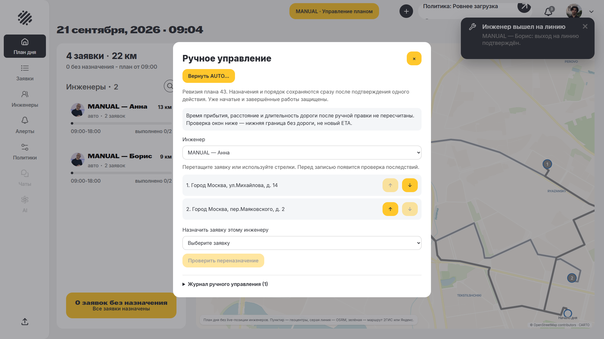
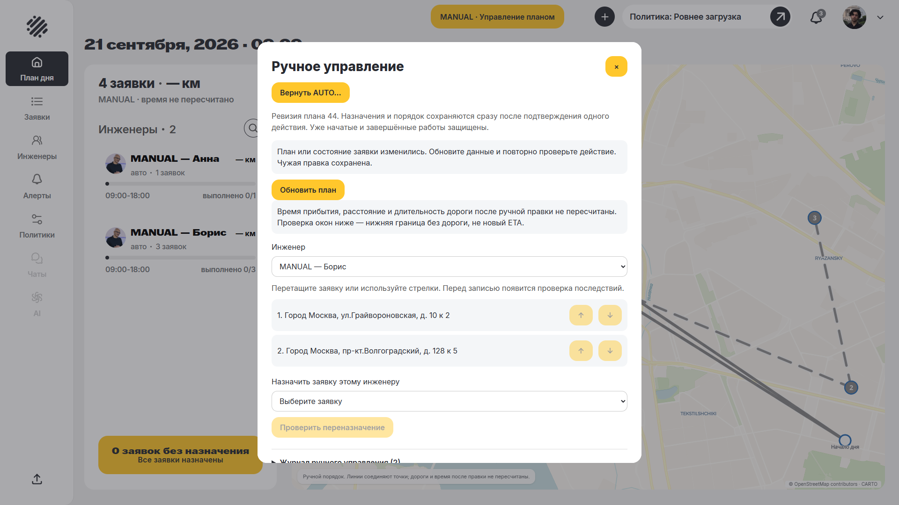
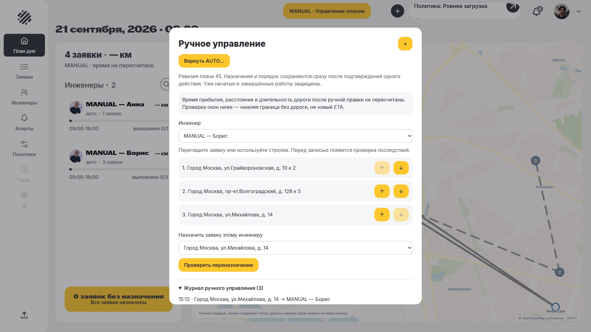
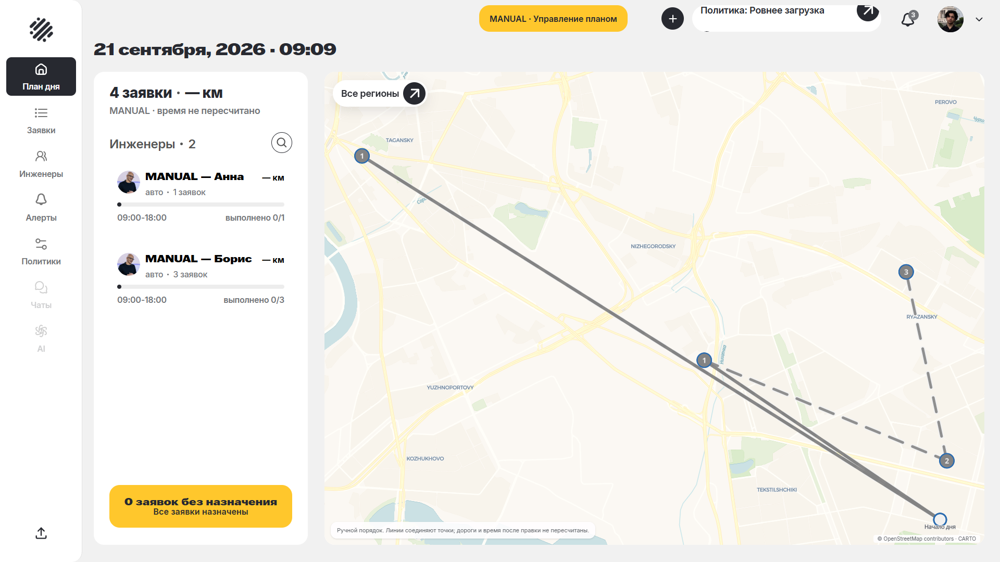
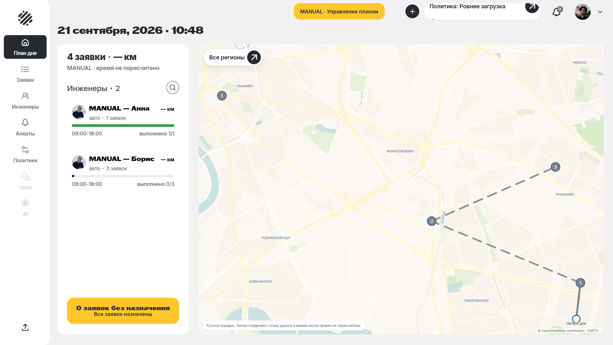
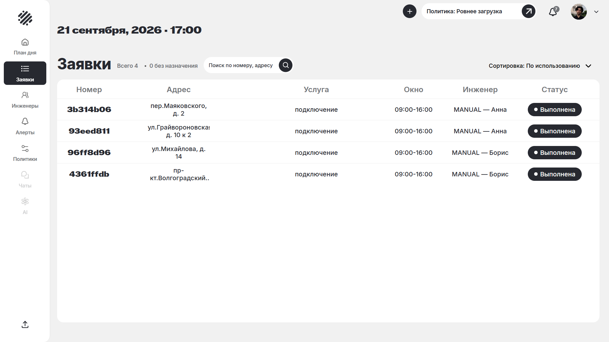
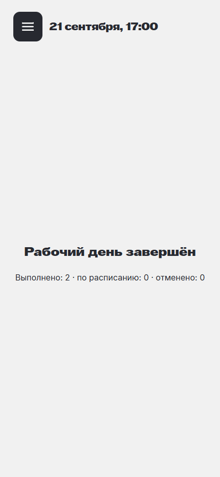

# MANUAL: локальная приёмка DRO-70

Основной 30-минутный прогон выполнен на версии `615b96e5729e2d26f1a3f3368c141516ca78d5bb`.

Прогон: **21.09.2026, 15:11:53 — 21.09.2026, 15:41:53**, Europe/Minsk. Монотонная длительность — **1800.3 с**, не менее 30 реальных минут. На отдельной PostgreSQL использованы четыре заявки и два инженера; работают настоящий System Layer и Router Core. Виртуальная смена ускорена до 30 минут через `speed_up_work_stub=1800`. Часы БД в ходе прогона вручную не перемещались.

Действия выполнены в браузере от диспетчера и обоих инженеров. Состояние проверялось через API каждые 30 секунд. Router и API действительно останавливались и запускались как отдельные локальные процессы. Все четыре заявки завершены инженерами, в конце подтверждены AUTO, отсутствие незавершённых работ и сохранённые факты. Отдельная SQL-сверка подтвердила 8 фактов начала/завершения и 0 расхождений с временными полями четырёх заявок. Необработанных ошибок страниц — 0.

| Время | Подтверждённый шаг |
|---|---|
| 21.09.2026, 15:12:24 | Причина, отмена, drag-and-drop, переназначение, конфликт вкладок, журнал и экран инженера |
| 21.09.2026, 15:13:55 | Начатую работу переназначить нельзя |
| 21.09.2026, 15:17:55 | Ручная правка при остановленном процессе Router |
| 21.09.2026, 15:21:59 | Результат после запуска Router не заменил ручной план |
| 21.09.2026, 15:24:05 | Перезапуск API сохранил режим, план и факты |
| 21.09.2026, 15:25:55 | Новое переназначение после перезапуска |
| 21.09.2026, 15:31:53 | Все четыре работы завершены явными действиями инженеров |
| 21.09.2026, 15:33:57 | Явный AUTO применён, факты завершения сохранены |
| 21.09.2026, 15:41:53 | Полные 30 минут пройдены, итоговое состояние проверено |

Машинный журнал с UTC-временем, ревизиями и счётчиками: [run.json](run.json). Промежуточные отладочные попытки не включены в этот результат.

Воспроизведение и контракт: [docs/manual-control.md](../../docs/manual-control.md). Входной набор: [manual-control.json](../../data/demo/manual-control.json); генератор умеет переносить его на текущую дату. Это синтетический сценарий на четырёх узлах официального графа, не бенчмарк всего датасета. 2ГИС и пробки не проверялись в рамках этой задачи. Вручную изменённые ETA и дорожные метрики явно помечены как непересчитанные.

## Уточнение после прогона

После возврата AUTO новый план будущих работ уже не содержит завершённые заявки.
В общей таблице из-за этого пропадало имя исполнителя, хотя сама связь сохранялась
в истории. Исправление `1e1c1fa` использует существующую историю LIVE только для
завершённых/отменённых визитов. Оно не меняет план, назначения или факты.

Поправка проверена отдельно на том же сохранённом дне: четыре строки «Выполнена»,
два визита Анны и два Бориса; ошибок страницы нет. Результат —
[history-ui-check.json](history-ui-check.json). Обновлённый снимок таблицы включён
в галерею ниже; исходный снимок до этой поправки сохранён как
[completed-requests.png](completed-requests.png).

## Автоматические проверки финального кода

| Проверка | Результат |
|---|---|
| API: unit и профильные интеграции, включая 14 сценариев MANUAL | 199/199 |
| API: инженеры в отдельной БД Docker-гейта | 26/26 |
| Frontend | 234/234 |
| Smoke с настоящим Router | 21/21 |
| Браузер: основной контур и остановка/возврат Router | 8/8 |
| API/web build и типы E2E | пройдены |
| Biome | 0 ошибок, 7 существовавших предупреждений |

Машинная сводка: [verification.json](verification.json). Проверки дополнены отдельным
30-минутным прогоном выше; короткие тесты не подменяют его длительность.

## Скриншоты

### Редактор очереди в MANUAL

### Конфликт двух вкладок без потери первой правки

### Серверный журнал причины и ручных действий

### Текущий ручной порядок на карте, архивный пробег скрыт

### Экран инженера с явной отметкой «Без ETA»

### Сохранённое ручное изменение во время остановки Router

### Четыре выполненные заявки

### Итоговый экран инженера

