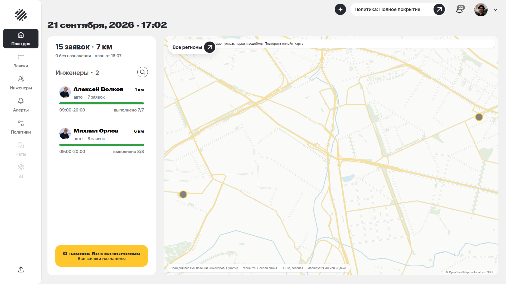
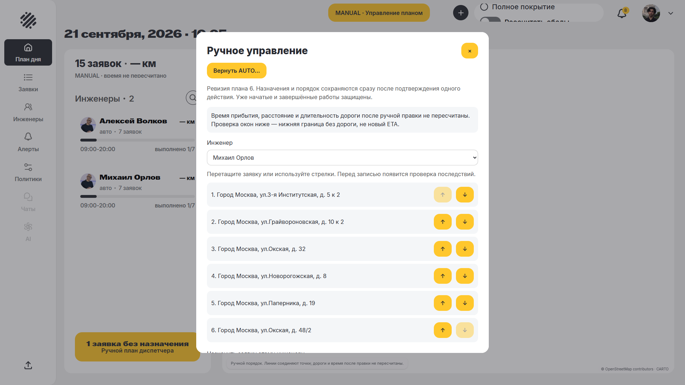
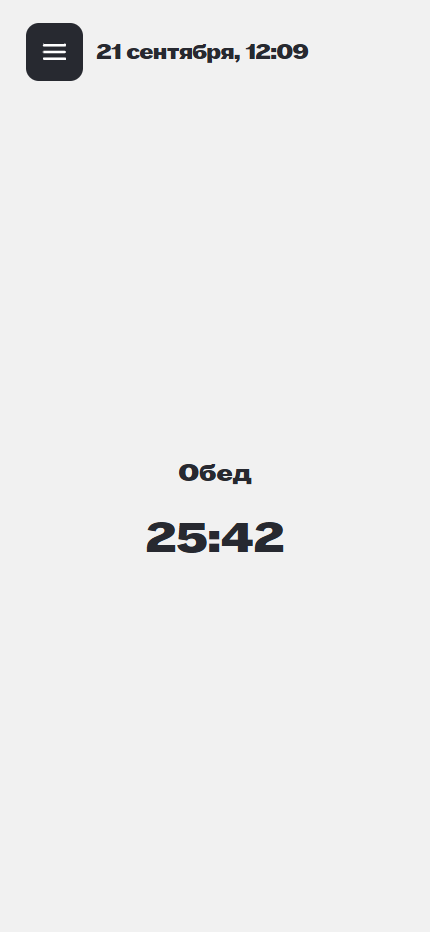
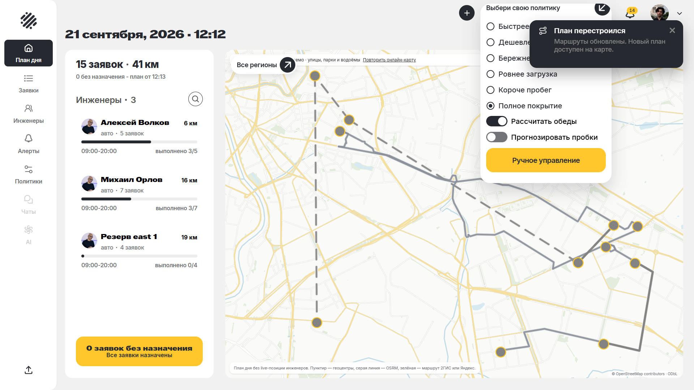
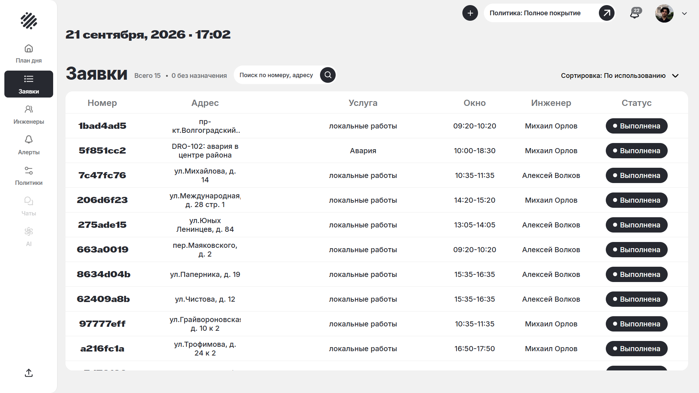
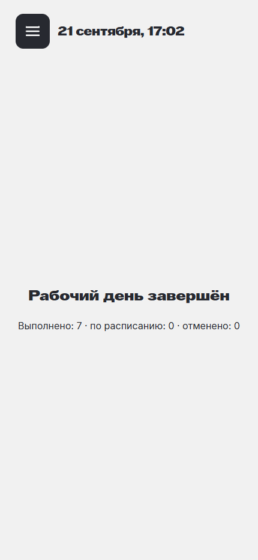

# Демо-день после исправлений DRO-102

Проверенная версия: `50e17f0a74953c6f6fda37b06c105ad2296bf81b`. Контрольные суммы исходников —
[demo-source-checksums.json](demo-source-checksums.json).

**21.09.2026, 21:57:43 — 21.09.2026, 22:27:44, Europe/Minsk.**
Монотонная длительность наблюдения — **1801.4 с**, не менее
30 реальных минут. День запущен кнопкой диспетчера, `speed_up_work_stub=1800`;
часы БД вручную не перемещались. Начальный набор — 14 заявок / 2 инженера,
`buildLiveDemo` на 21.09.2026 с локальными координатами East. Ещё одна аварийная
заявка создана диспетчером через форму и выбор точки на карте.

Работали настоящие API, PostgreSQL и Router. Отдельная база `lct_solver_demo2`
не затрагивает рабочие данные и базу с ключом 2ГИС. Ключи внешних карт и SMTP
не подключены; внешние запросы браузера намеренно блокировались, основная карта
использовала локальную подложку. Квота 2ГИС не расходовалась.

## Проверенные действия

| Сценарий | Наблюдаемый результат |
|---|---|
| Старт диспетчера и выход двух инженеров | 14 начальных заявок назначены 7+7 |
| Раннее завершение | Факт первой работы — 286 с при нормативе 1800 с |
| Дополнительное время с причиной | Сохранён запрос ещё 40 минут; фактическая работа закончилась через 1958 с |
| Новая аварийная заявка | Создана через UI, получила urgent / emergency и назначение |
| Снять инженера со смены / вернуть | Будущие назначения пересчитаны, уже выполненные работы сохранены |
| MANUAL | Проверены обязательная причина, drag-and-drop, переназначение, аудит и явный AUTO |
| Прогноз пробок выключен / включён | Проверены обе ветки локального расчёта; внешних данных о текущих пробках нет |
| ETA 12:20 вместо 11:50 | Обещание сохранено, резервирование учтено; новый план перенёс обед после него |
| Обеды и техперерыв | Оба инженера увидели блокирующий экран обеда; начало/конец техперерыва изменили доступность |
| Политика «Полное покрытие» | Ранее неназначенная работа вернулась в план с дополнительной резервной бригадой; это другая политика и состав ресурсов |
| Завершение и перезагрузка экранов | Все 15 заявок завершены явно; статусы и факты сохранились после reload |

Операции выполнялись видимыми кнопками и полями браузера. После первых сценариев
агент продолжал нажимать доступные «Приступить» / «Завершить», соблюдая клиентские
окна и блокирующие обеды. Поэтому продолжительность работ здесь — сценарные факты,
а не измерение реальной работы выездных инженеров.

Все 15 работ завершились примерно на 22-й реальной минуте; бизнес-день штатно
закрылся в 17:02 с `schedule_exhausted`. Наблюдение продолжалось до полных
30 минут: проверены сохранность состояния, обе роли и перезагрузка страниц.
Отладочная попытка на предыдущей версии длилась 290,8 с и **не включена**
в эти 30 минут.

Политика `covering` по действующему контракту может добавлять синтезированные
региональные бригады. В промежуточном плане и снимке ниже показан «Резерв east 1».
После следующих фактов раннего завершения весь оставшийся объём вернулся двум
исходным инженерам; все факты start/finish принадлежат только им. Поэтому эффект
выбора этой политики нельзя выдавать за улучшение при неизменном составе.

## Проверка состояния

- 15 выполненных заявок: Алексей — 7, Михаил — 8; 0 отмен и 0 завершений «по расписанию».
- 30 фактов начала/завершения; SQL: 0 расхождений с временными полями заявок, 0 дубликатов.
- 106 снимков API; 812 сравнений уже сохранённых фактов завершения без изменения статуса или времени.
- 0 необработанных ошибок страниц; после reload нет Vite overlay, экраны обеих ролей доступны.
- Одна запись console `net::ERR_NO_BUFFER_SPACE` в 19:10:35 UTC. Причина и URL
  не установлены: первоначальный listener сохранял только текст. Наблюдаемого
  отказа действий или потери данных не было. После добавления `requestfailed`
  listener новых сбоев не обнаружено. Это отдельное наблюдение, а не подтверждённая
  ошибка приложения или установленная проблема среды.
- Сообщений console от намеренно заблокированных OSM/CARTO-ресурсов: 63.
  Они не считаются чистой консолью и сохранены в классификации.

Среда: Microsoft Edge через Playwright; Browser plugin недоступен. Диспетчер —
1920×1080, инженеры — 430×932. Живые внешние маршруты и другие браузеры в этом
прогоне не проверялись; 2ГИС имеет отдельную приёмку в [../maps](../maps/README.md).

Машинные доказательства: [журнал](demo-run.json), [сводка](demo-verification.json),
[SQL-сверка фактов](demo-facts.json), [история состояний](demo-state-history.json),
[журнал MANUAL](demo-manual-audit.json),
[начальный пакет](demo-input.json). Замеры производительности приведены отдельно
в [основном отчёте](README.md); этот прогон проверяет взаимодействие и сохранность.

## Воспроизведение

1. Поднять отдельную локальную PostgreSQL, применить существующие миграции; выдать
   Router штатный read-only доступ к snapshot-view. Не использовать рабочую БД.
2. Запустить текущие API/Router/web по [runbook](../../docs/runbook.md) с
   `DEMO_STAND=false`, `speed_up_work_stub=1800`, без внешних ключей и SMTP.
3. Собрать API командой `pnpm --filter api test:build` и выполнить существующий
   `apps/api/dist-test/scripts/live-demo.js` с локальными `DATABASE_URL`,
   `LIVE_DEMO_BASE_URL` и учётной записью диспетчера. Генератор использует текущую
   московскую дату; загружать сохранённый пакет другого дня без переноса окон нельзя.
4. Связать обоих тестовых инженеров с локальными учётными записями, войти в
   диспетчерскую и два независимых мобильных сеанса. Запустить день через UI.
5. Повторить сценарии таблицы, наблюдать не менее 1800 реальных секунд;
   сохранять факты и ревизии до/после пересчётов. Доступность тестовых login-кодов
   допустима только в локальном `NODE_ENV=test`.

## Скриншоты

Итоговый дашборд снят 21.09.2026, 22:29:50, Europe/Minsk,
после окончания 30-минутного наблюдения на том же
сохранённом дне. Остальные кадры сделаны во время прогона.

