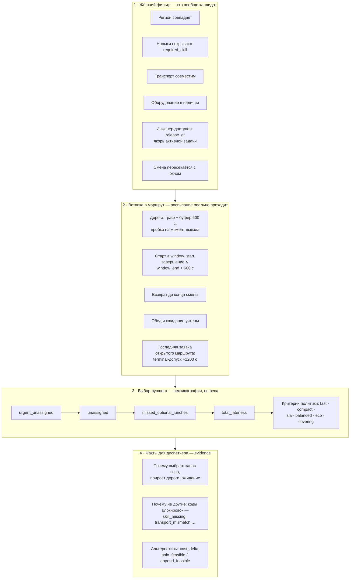
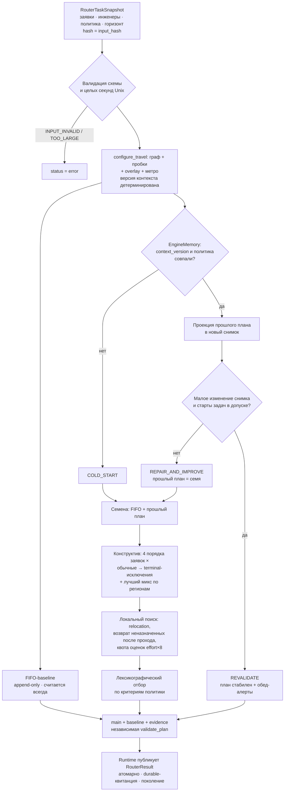
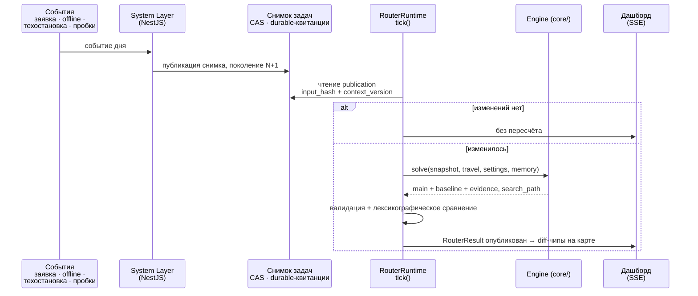
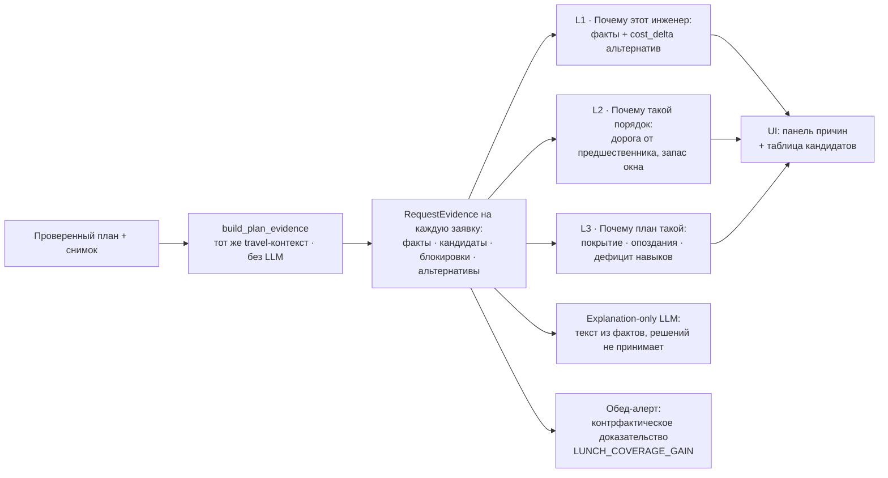
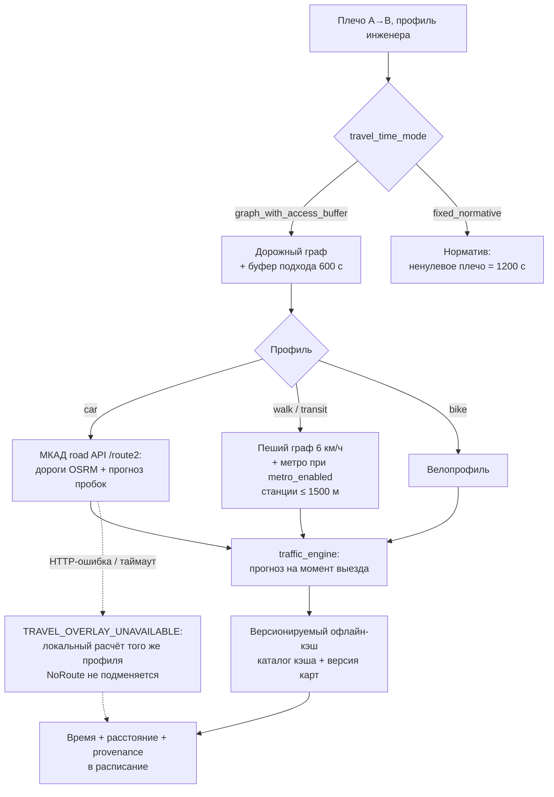

# Схемы для презентации: решатель и его окружение

Источник фактуры — код и документация, не придумано: `core/engine.py`, `core/policy.py`,
`core/evidence.py`, `core/route_search.py`, `core/runtime.py`, `core/schedule.py`,
`docs/solver.md`, `context/11`. Mermaid-черновики можно перерисовать в любом редакторе —
структура и подписи блоков совпадают с реальными именами в коде.

---

## 1. Как роутер принимает решение (факторы)

**Что показывает:** решение — это не «магия весов», а воронка из четырёх слоёв:
жёсткий отсев кандидатов → проверка реальной вставки в расписание → лексикографическое
сравнение по политике → факты-доказательства для диспетчера.

**Блоки (точные значения из кода):**

- **Слой 1 — жёсткий фильтр** (`evidence.py`, `schedule.py: eligible`): регион,
  навыки ⊇ `required_skill`, совместимость транспорта, оборудование в наличии,
  доступность (`release_at` — якорь активной задачи), пересечение смены с окном.
- **Слой 2 — вставка в маршрут** (`schedule.py: schedule_steps`): дорога (граф + буфер
  подхода 600 с, прогноз пробок на момент выезда); старт работ ≥ открытия окна;
  завершение ≤ закрытия окна + допуск 600 с; возврат до конца смены; обед и ожидание.
  Последняя заявка открытого маршрута — terminal-допуск +1200 с.
- **Слой 3 — иерархия целей** (`policy.py`): лексикография, не взвешенная сумма.
  Общая часть для всех политик: `urgent_unassigned → unassigned →
  missed_optional_lunches → total_lateness`, затем критерии политики.
- **Слой 4 — факты для диспетчера** (`evidence.py`): запас окна, прирост дороги,
  ожидание, коды блокировок кандидатов, альтернативы с дельтой стоимости.

| Политика (пресет) | Что минимизирует после общей части | Когда показывать |
|---|---|---|
| `compact` — по умолчанию | число задействованных инженеров → расстояние → дорога | экономный штат |
| `fast` | время дороги → расстояние → число инженеров | скорость доезда |
| `sla` | минимальный запас до закрытия окна (`window_end_risk`) | риск опозданий |
| `balanced` | макс. доля занятости смены → разброс занятости | равномерная загрузка |
| `eco` | расстояние → число инженеров → дорога | километраж/экология |
| `covering` | минимум доп. бригад (`additional_engineers`) | пиковый спрос |

---

## 2. Пайплайн алгоритма движка роутинга

**Что показывает:** один расчёт от снимка до публикации — с тремя путями поиска
(`REVALIDATE`, `REPAIR_AND_IMPROVE`, `COLD_START`) и параллельным FIFO-baseline.

**Блоки:**

1. **Вход:** `RouterTaskSnapshot` (неизменяемый, `input_hash`) → валидация схемы и
   целых секунд Unix. Ошибка → `RouterResult.status=error` с кодами
   `INPUT_INVALID` / `INPUT_TOO_LARGE`.
2. **Travel-контекст:** `configure_travel` собирает граф + пробки + overlay + метро;
   версия контекста = версия графа + тайминг-настройки (детерминизм).
3. **FIFO-baseline** — append-only план «в порядке поступления», считается **всегда**:
   это строка сравнения, доказывающая ценность оптимизации.
4. **Память (`EngineMemory`):** если `context_version` и политика совпали — прошлый
   план проецируется в новый снимок. Малое изменение и старты в допуске →
   `REVALIDATE` (план стабилен, добавляются обед-алерты).
5. **Иначе:** `COLD_START` или `REPAIR_AND_IMPROVE` (прошлый план = семя).
6. **Конструктив** (`route_search.py`): 4 порядка заявок (urgent → окно → длина и т.д.)
   × два прохода (сначала обычные заявки, затем terminal-исключения) + лучший микс
   по несвязным регионам.
7. **Локальный поиск:** relocation, перестановки, возврат неназначенных после каждого
   прохода; детерминированная **квота оценок** (`effort × 8`), не чистый wall-time.
8. **Отбор:** лексикографическое сравнение по критериям политики; независимая
   перепроверка `validate_plan`.
9. **Выход:** main + baseline + evidence → `RouterResult` → Runtime публикует атомарно
   (durable-квитанция, поколение).

---

## 3. Живое перепланирование (event → план → экран)

**Что показывает:** ключевое требование кейса — re-plan на лету. События не мутируют
план напрямую: они публикуют новый снимок, движок решает — пересчитать или
переутвердить, диспетчер видит diff.

**Блоки:** события (новая обычная/срочная заявка, инженер offline, техостановка ×2,
множитель пробок 3× — ровно пять acceptance-сценариев) → System Layer публикует снимок
(CAS, durable-квитанции) → `RouterRuntime.tick()` читает publication, сравнивает хэш →
путь из схемы 2 → лексикографическое сравнение с текущим планом (ухудшение не
публикуется) → SSE → diff-чипы на карте.

---

## 4. Объясняемость: от факторов к доверию (L1/L2/L3)

**Что показывает:** explainability — заявленная фишка проекта. Причины не пишутся
руками и не генерируются LLM произвольно: считаются детерминированные факты, LLM
только превращает их в текст (D-11), у диспетчера всегда есть сырая таблица.

**Блоки:**

- **L1 — почему этот инженер:** факты выбранного кандидата + альтернативы с
  `cost_delta` и кодами `why_not` (8 блокировок: `region_mismatch`, `skill_missing`,
  `transport_mismatch`, `equipment_missing`, `unavailable`,
  `solo_schedule_infeasible`, `current_route_append_infeasible`,
  `equipment_stock_exhausted`).
- **L2 — почему такой порядок:** дорога от предшественника, ожидание, запас окна
  (`end_margin`), стартовое смещение.
- **L3 — почему план такой:** покрытие, опоздания, дефицит квалификаций, риск окон.
- **Обед-алерт — контрфактическое доказательство:** найдена допустимая вставка
  неназначенной заявки в тот же порядок без обеда, когда с обедом не проходит
  (`LUNCH_COVERAGE_GAIN`, проверяется независимо).

---

## 5. Стек оценки времени в пути и офлайн-устойчивость

**Что показывает:** откуда берётся каждая минута ETA и почему демо работает без
интернета. Отличие от уже сделанной схемы «типы маршрутов»: там — какие бывают
маршруты, здесь — как считается время и что происходит при отказе внешнего API.

**Блоки:**

- `travel_time_mode`: `graph_with_access_buffer` (граф + буфер подхода 600 с) или
  `fixed_normative` (любое ненулевое плечо = 1200 с).
- Профили: **car** — МКАД road API `/route2` (дороги OSRM + его прогноз пробок);
  **walk/transit** — пеший граф 6 км/ч; опционально метро (включение`metro_enabled`:
  станции в радиусе 1500 м, выбирается только строго более быстрый вариант; вход
  180 с · выход 120 с · ожидание 120 с · пересадка 240 с); **bike** — свой профиль.
- `traffic_engine` — прогноз на момент **каждого выезда**, не одна матрица на день.
- Отказ провайдера: один лог `TRAVEL_OVERLAY_UNAVAILABLE` на профиль за расчёт →
  откат к локальному расчёту того же профиля; кэш продолжает читаться; `NoRoute`
  не подменяется прямой линией.

---

## 6. Детерминизм и проверяемость (golden-гейт)

**Что показывает:** почему плану можно верить и почему его нельзя «случайно» изменить.
Прямо отвечает критерию воспроизводимости.

**Блоки:** детерминизм по построению (узлы по id, один seed, один поток, квоты оценок
вместо чистого wall-time) → golden-хэши трёх сценариев (Восток 66 заявок, Юг-Центр 56,
Юго-Восток 83; один снимок 205 заявок / 35 инженеров) → FIFO-baseline как строка
сравнения → регрессии и `pnpm smoke` → правило: сдвиг golden требует перегенерации
снимка и объяснения в теле коммита.

**Цифры для слайда (официальная приёмка):** Восток — FIFO 30/66 назначений (срочных
1/13) против Router 59/66 (11/13); Юг-Центр — 27/56 (1/16) против 47/56 (15/16).

---

## Что уже нарисовано вручную и чему это соответствует

| Схема | Соответствие в коде |
|---|---|
| Архитектура (сделана) | `docs/architecture.md`, `context/32` |
| Типы маршрутов (сделана) | транспортные профили, метро (`docs/solver.md` § метро) |
| Факторы решения (эта док., §1) | `core/policy.py`, `core/evidence.py`, `core/schedule.py` |
| Пайплайн движка (§2) | `core/engine.py: solve/_solve_prepared`, `core/route_search.py` |
| Живой цикл (§3) | `core/runtime.py: tick`, `docs/live.md` |
| Объясняемость (§4) | `core/evidence.py`, `context/11`, `context/29` D-11 |
| Время в пути (§5) | `core/geo.py`, `core/traffic_engine.py`, `core/metro.py`, `core/road_api.py` |
| Детерминизм (§6) | `core/tests/golden`, `context/27` §10 |
